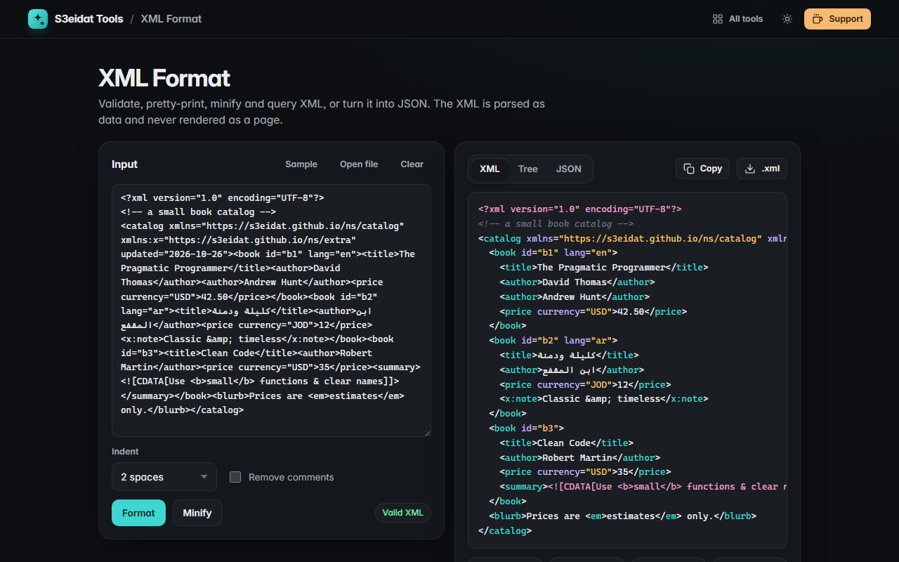

# XML Format

> Validate, pretty-print, minify and query XML, and convert it to JSON. Free, private, and it runs entirely in your browser.

### ▶ [Open XML Format](https://s3eidat.github.io/xml-format/)



## Features

- **Validate** with the browser's own XML parser (`DOMParser`), with the parser's message and the **line and column** in context
- **Pretty-print** with 2 spaces, 4 spaces or tabs; **minify** to one line; optionally remove comments
- Text is never trimmed or re-escaped: CDATA sections, entities, mixed content (`text <i>x</i> text`) and `xml:space="preserve"` stay exactly as written
- **Collapsible tree** view; click an element name to copy its XPath (`/d:catalog/d:book[2]/d:title`)
- **XPath tester** using the browser's XPath engine on the parsed document, with **namespace prefixes** picked up from the file;
  a default namespace is bound to the prefix `d:`. Returns nodes, numbers, strings or booleans; click a result to copy it
- **XML → JSON** (`@attr` for attributes, `#text` for text next to attributes, repeated elements become arrays)
- Open or drop `.xml`, `.svg`, `.xsd`, `.rss`, `.plist` and similar files; copy or download the XML or JSON

## Safety

The XML is parsed into an inert XML document that is never attached to the page, and the output is shown as text.
Nothing in the XML is rendered, run or loaded.

## Privacy

Your XML never leaves your device. There is no server, no account, no analytics.
The page ships with a strict Content-Security-Policy (`connect-src 'self'`), so the browser
itself blocks any attempt to send data anywhere.

## Run it yourself

It's plain HTML, CSS and JavaScript with no build step:

```bash
git clone https://github.com/s3eidat/xml-format
cd xml-format
python -m http.server 8000
```

Then open http://localhost:8000.

## Support

If this saved you time, **[buy me a coffee ☕](https://s3eidat.github.io/coffee/)**. It keeps every tool free.

---

Part of **[S3eidat Tools](https://s3eidat.github.io/)**: 100+ free, private tools that run in your browser. MIT licensed.
